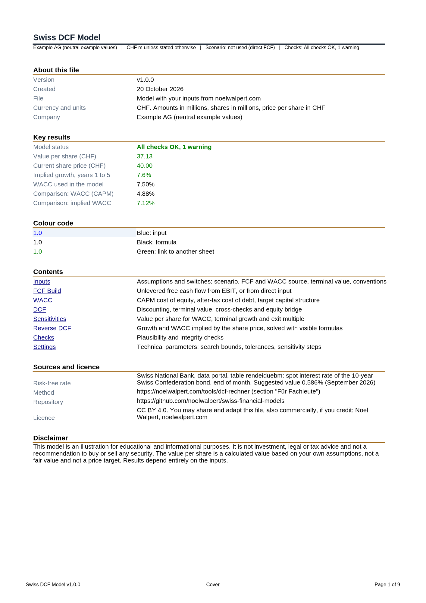
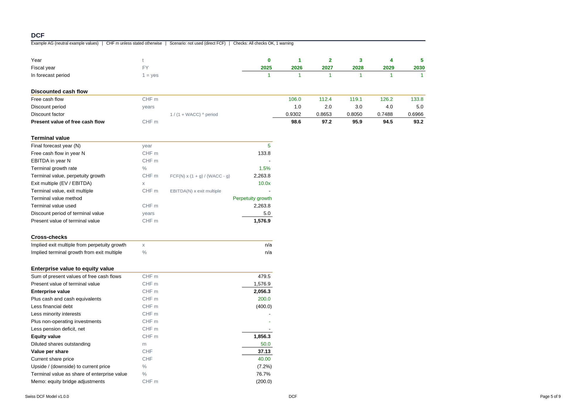

# Swiss DCF Model

An Excel model that values a company with discounted cash flows and also answers the reverse question: which growth does the current share price assume?

Version 1.0.0. Currency: Swiss francs, amounts in millions, shares in millions, share price in CHF. Online version: [noelwalpert.com/tools/dcf-rechner](https://noelwalpert.com/tools/dcf-rechner).

## Files

| File | Content |
|---|---|
| [`swiss-dcf-template-v1.0.0.xlsx`](swiss-dcf-template-v1.0.0.xlsx) | Empty template. Only the switches and the technical parameters are set. Results show "n/a" and the status "Inputs missing" until you fill in the blue cells |
| [`swiss-dcf-example-v1.0.0.xlsx`](swiss-dcf-example-v1.0.0.xlsx) | The same model filled with neutral example values of an invented company, not a real one |



## Who it is for

Students, analysts and investors who want a transparent DCF with formulas they can follow, and a quick way to see what a share price implies. It is a teaching and screening tool. It is not meant to replace a full company model with segment detail, leases, share based pay or a detailed balance sheet.

## The nine sheets

| Sheet | Purpose |
|---|---|
| Cover | Version, key results, model status, colour code, contents, sources, licence, disclaimer |
| Inputs | All assumptions and the six switches: forecast period (5 or 10 years), discounting (year-end or mid-year), scenario (Bear, Base, Bull), free cash flow source (Direct or Build), WACC source (Direct or CAPM), terminal value method (perpetuity growth or exit multiple) |
| FCF Build | Unlevered free cash flow per year, either from the direct input or derived from revenue and EBIT margin |
| WACC | CAPM cost of equity, after-tax cost of debt, target capital structure. Both the direct and the CAPM WACC are shown |
| DCF | Discounting, terminal value with cross-checks, bridge from enterprise value to equity value and value per share |
| Sensitivities | Value per share for WACC against terminal growth, and WACC against exit multiple, 5 by 5 cells each. Cells above the share price are light blue, cells below are light amber |
| Reverse DCF | Growth and WACC implied by the share price, solved with visible formulas |
| Checks | 18 plausibility and integrity checks |
| Settings | Technical parameters: search bounds, tolerances, steps of the sensitivity tables |



## Colour code

| Colour | Meaning |
|---|---|
| Blue font, light blue fill | Input. Change these cells |
| Black font | Formula on the same sheet |
| Green font | Link to another sheet |
| Grey font | Not used with the current switches |

Cells that are not inputs contain only formulas. Numbers typed into formulas are limited to structural constants such as 0, 1, 2, 12 and 100.

## How to use

1. Open the template in Excel (desktop or browser). Excel calculates the file when it opens. Viewers that do not calculate, for example some preview panes, show empty result cells.
2. On Inputs, set the switches or keep the defaults (direct free cash flow, direct WACC, perpetuity growth, year-end, 5 years).
3. Fill in the blue cells. With the direct source you need the base year free cash flow and its growth. With the build you need revenue, margins, tax, depreciation, capital expenditure and net working capital.
4. Enter cash, financial debt, diluted shares and the current share price.
5. Read the results on Cover and DCF. Check the status on Checks. An ERROR must be fixed, a WARNING deserves a second look, an INFO is for information only.

Expected result of the example file: value per share CHF 37.13 against a share price of CHF 40.00, implied free cash flow growth of 7.6 % per year in years 1 to 5, WACC 7.50 %.

## Method in short

Notation: t is the forecast year, N the last forecast year (5 or 10), W the WACC, g the growth rate, g∞ the terminal growth rate and m the timing shift (0 for year-end, 0.5 for mid-year discounting).

**Valuation date.** The end of the base fiscal year. There is no stub period.

**Free cash flow, direct.** FCF(t) = FCF(0) × (1 + g)^t. With 10 years, growth in years 6 to 10 falls linearly from g to g∞.

**Free cash flow, build.**

```
Revenue(t) = Revenue(t-1) × (1 + revenue growth(t))
EBIT(t)    = Revenue(t) × EBIT margin(t)
NOPAT(t)   = EBIT(t) × (1 - tax rate)
FCF(t)     = NOPAT(t) + depreciation(t) - capital expenditure(t) - change in net working capital(t)
EBITDA(t)  = EBIT(t) + depreciation(t)
```

Tax is charged on EBIT even when EBIT is negative. There are no loss carryforwards.

**WACC.**

```
Cost of equity = risk-free rate + beta × market risk premium          (CAPM)
WACC           = E/V × cost of equity + D/V × cost of debt × (1 - tax rate)
```

The weights are target weights, not balance sheet values. Beta can be entered directly or relevered from an unlevered beta.

**Discounting.** Discount factor(t) = 1 / (1 + W)^(t - m). Present value of the forecast = sum of FCF(t) × discount factor(t).

**Terminal value.**

```
Perpetuity growth: TV = FCF(N) × (1 + g∞) / (W - g∞)    PV = TV / (1 + W)^(N - m)
Exit multiple:     TV = EBITDA(N) × multiple             PV = TV / (1 + W)^N
```

Each method shows the other as a cross-check: the exit multiple implied by perpetuity growth, and the terminal growth implied by the exit multiple.

**Equity bridge.**

```
Enterprise value = PV of forecast + PV of terminal value
Equity value     = enterprise value + cash - financial debt - minority interests
                   + non-operating investments - net pension obligations
Value per share  = equity value / diluted shares
```

**Reverse DCF.** The model searches the growth rate for which the value per share equals the share price, with everything else unchanged. It uses bisection: each row halves the search interval, and after 60 rows the interval is far below any rounding. No Goal Seek, no macro and no circular reference, so the result updates when an input changes. With direct input the search replaces the free cash flow growth of years 1 to 5. With the build it replaces revenue growth, and margins stay as entered. A second search finds the implied WACC. The search bounds are on Settings.

## Limits

- Swiss francs only. There is no currency conversion.
- No stub period: the valuation date is the end of the base fiscal year.
- Tax is charged on EBIT, also when negative, without loss carryforwards.
- The WACC uses target weights. It does not iterate between value and capital structure.
- Scenarios (Bear, Base, Bull) change revenue growth, EBIT margin and exit multiple and only apply to the free cash flow build. With direct input they have no effect.
- The exit multiple needs EBITDA and therefore the build.
- The sensitivity tables hold the free cash flows constant. Only discounting and the terminal value change.
- The reverse DCF assumes that the value rises with growth. That holds for positive free cash flow. With a negative base free cash flow there is no implied growth, and the model says so.
- The suggested risk-free rate is the Swiss Confederation bond, 10 years, end of month (Swiss National Bank, data portal, table rendeiduebm: September 2026, 0.586 %). It is a suggestion and you can overwrite it. The very low Swiss rate often makes the cost of equity look low, so many practitioners use a normalised rate. The market risk premium of 5.0 % in the example is an illustrative value without a source.
- A result is only as good as its inputs. The value per share is a calculated value, not a fair value and not a price target.

## Verification

The same code generates these files and the downloads on noelwalpert.com. Before release the model was checked as follows:

- Five test cases times three scenarios, plus boundary cases and the empty template, were recalculated with LibreOffice and compared with two independent implementations (TypeScript and Python). The comparison covered WACC, free cash flows and present values per year, derivation, terminal value, equity bridge, cross-checks, all 75 sensitivity cells, implied growth, implied WACC and the checks. 2,556 numbers were compared, the largest relative deviation was 4.9e-15, and no cell showed an error value.
- A structure test checks that there are no macros, that every name is defined, that only a fixed list of functions is used, and that typed numbers appear only in blue input cells.
- The author checked the files by hand in Excel.

LibreOffice and Excel calculate the same way in almost all cases, but this is not guaranteed. If you find a difference, please write to noel@walpert.ch.

## Cite

Walpert, N. (2026). *Swiss DCF Model* (version 1.0.0). https://github.com/noelwalpert/swiss-financial-models

## Not investment advice

This model is an illustration for educational and informational purposes. It is not investment, legal or tax advice and not a recommendation to buy or sell any security. Results depend entirely on the inputs.

## Licence and contact

CC BY 4.0, see [LICENSE](../LICENSE). Credit: Noel Walpert, noelwalpert.com. Contact: noel@walpert.ch.
