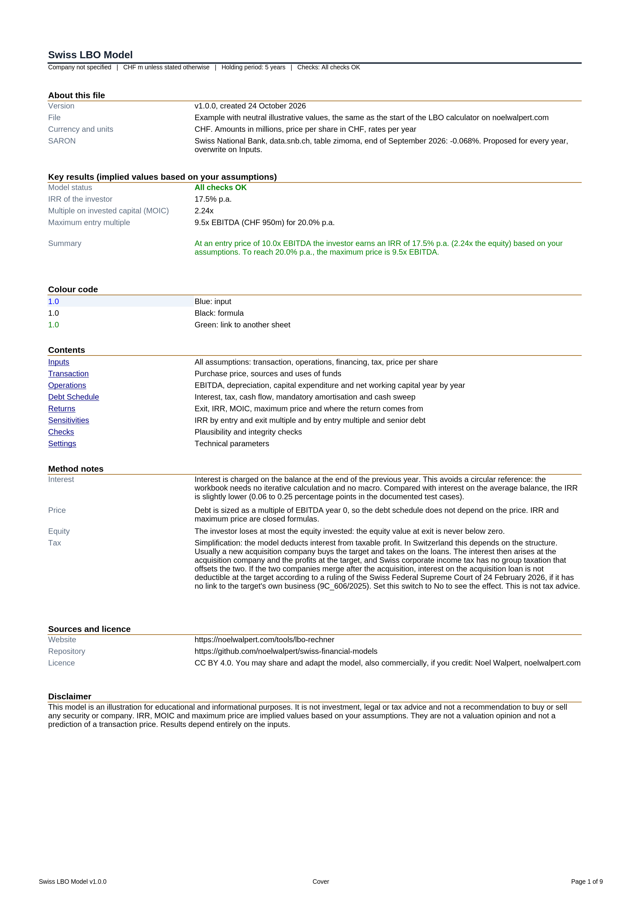
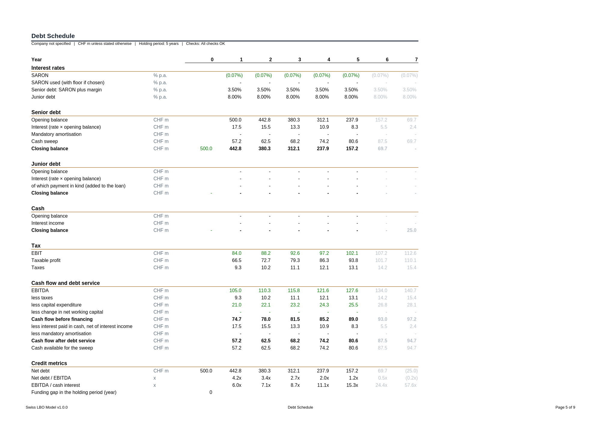
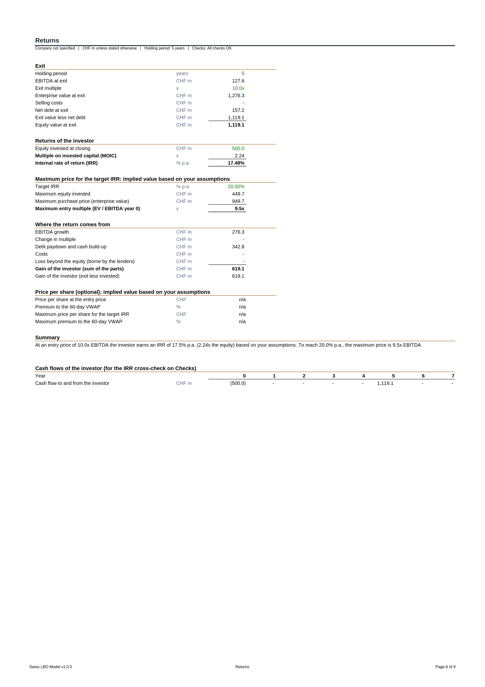
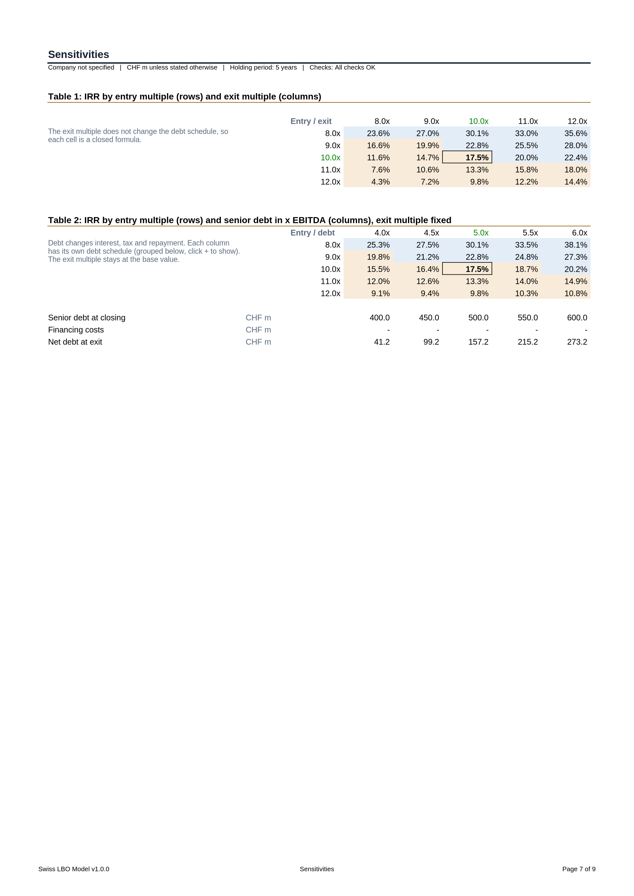

# Swiss LBO Model

An Excel model of a leveraged buyout that answers two questions. Which return (IRR and multiple on invested capital) does a financial investor earn at a given purchase price? And which price can the investor pay at most to reach a target return?

Version 1.0.0. Currency: Swiss francs, amounts in millions. Interest is SARON plus a margin. Online version: [noelwalpert.com/tools/lbo-rechner](https://noelwalpert.com/tools/lbo-rechner).

## Files

| File | Content |
|---|---|
| [`swiss-lbo-template-v1.0.0.xlsx`](swiss-lbo-template-v1.0.0.xlsx) | Empty template. Only the switches and the technical parameters are set. Results show "n/a" and the status "Inputs missing" until you fill in the blue cells |
| [`swiss-lbo-example-v1.0.0.xlsx`](swiss-lbo-example-v1.0.0.xlsx) | The same model filled with neutral example values of an invented company, the same values as the start of the online calculator |



## Who it is for

Students, analysts and investors who want a transparent LBO model with formulas they can follow: sources and uses, a debt schedule with cash sweep, returns and where they come from. It is a teaching and screening tool. It does not replace a full transaction model with a revolving credit facility, management equity, dividend recaps or a detailed balance sheet.

## The nine sheets

| Sheet | Purpose |
|---|---|
| Cover | Version, key results, model status, colour code, contents, method notes, sources, licence, disclaimer |
| Inputs | All assumptions: transaction, operations (build from EBITDA or from revenue with three scenarios), financing (SARON path, floor, senior and junior debt), fees and cash, tax, optional price per share |
| Transaction | Purchase price and sources and uses of funds at closing |
| Operations | EBITDA, depreciation, capital expenditure and net working capital year by year |
| Debt Schedule | Interest, tax, cash flow, mandatory amortisation, cash sweep, balances and credit metrics |
| Returns | Exit, equity value, MOIC, IRR, maximum price for the target IRR, attribution of the return, price per share |
| Sensitivities | IRR for entry against exit multiple, and for entry multiple against senior debt, 5 by 5 cells each |
| Checks | 19 plausibility and integrity checks |
| Settings | Technical parameters: time axis, steps of the sensitivities, tolerances |



## Colour code

| Colour | Meaning |
|---|---|
| Blue font, light blue fill | Input. Change these cells |
| Black font | Formula on the same sheet |
| Green font | Link to another sheet |
| Grey font | Year after the holding period, no effect on the result |

Cells that are not inputs contain only formulas. Numbers typed into formulas are limited to structural constants such as 0, 1, 2, 3 and 100.

## How to use

1. Open the template in Excel (desktop or browser). Excel calculates the file when it opens. Viewers that do not calculate, for example some preview panes, show empty result cells.
2. On Inputs, keep or change the switches: entry price as a multiple or an amount, exit multiple the same as entry or your own, build from EBITDA or from revenue, SARON floor, junior interest fixed or SARON based, paid in cash or in kind, interest deductible for tax.
3. Fill in the blue cells. Enter a SARON value for every year of the holding period.
4. Read the results on Cover and Returns. Check the status on Checks. An ERROR must be fixed, a WARNING deserves a second look, an INFO is for information only.

Expected result of the example file: entry at 10.0x EBITDA, IRR 17.5 % per year, MOIC 2.24x, maximum entry multiple for a 20 % target IRR 9.5x EBITDA.



## Method in short

Notation: t is the year, N the holding period (3 to 7 years), EBITDA(0) the EBITDA of the last year before the purchase.

**Sources and uses.** Purchase at the end of year 0, sale at the end of year N.

```
Purchase price (EV0) = entry multiple × EBITDA(0)
Senior debt          = senior multiple × EBITDA(0)
Junior debt          = junior multiple × EBITDA(0)
Equity invested      = EV0 × (1 + transaction costs) + financing costs + minimum cash - senior debt - junior debt
```

**Interest without a circular reference.** Interest is charged on the balance at the end of the previous year. It is known before the repayment of the year, so every row depends only on rows above it or on the previous year. The workbook needs no iterative calculation and no macro. Compared with interest on the average balance, the interest is slightly higher and the IRR slightly lower: 0.06 to 0.25 percentage points in the documented test cases.

```
Senior interest(t) = (max(SARON(t), 0) + margin) × senior balance(t-1)     (floor optional)
Taxes(t)           = tax rate × max(0, EBITDA(t) - depreciation(t) - interest(t))
Cash flow(t)       = EBITDA(t) - taxes(t) - capital expenditure(t) - change in net working capital(t)
Sweep(t)           = min(senior outstanding, sweep share × cash above the minimum cash)
```

**Exit and returns.** One payment in, one payment out, so the IRR is a closed formula. The function IRR on Checks confirms it.

```
Equity at exit = max(0, exit multiple × EBITDA(N) × (1 - selling costs) - net debt(N))
MOIC           = equity at exit / equity invested
IRR            = MOIC^(1/N) - 1
```

**Maximum price.** Debt is sized on EBITDA, so the debt schedule does not depend on the price.

```
Maximum equity = equity at exit / (1 + target IRR)^N
Maximum EV     = (maximum equity + debt - financing costs - minimum cash) / (1 + transaction costs)
```

**Attribution.** The gain of the investor splits without remainder into EBITDA growth (valued at the entry multiple), change in multiple (valued at the EBITDA at exit), debt paydown and cash build-up, costs, and the loss beyond the equity, which is borne by the lenders.

**Sensitivities.** Table 1 changes only entry and exit multiple and uses closed formulas. Table 2 changes the senior debt, which changes interest, tax and repayment, so each of its five columns has its own debt schedule (grouped below the table). No data tables.



## Swiss inputs and sources

- **SARON.** The example uses the SARON of the Swiss National Bank at the end of September 2026, minus 0.068 % (data.snb.ch, table zimoma). There is no public forecast of SARON, so the same value is proposed for every year. Overwrite each year with your own assumption.
- **Tax rate.** The example uses 14 %. Profit and capital taxes of the Confederation, canton and municipality in 2025 ranged from 12.01 % (Stans) to 20.26 % (Zurich) of profit before tax in the cantonal capitals (Swiss Federal Tax Administration, Steuerstatistik 2025, page 13: companies with capital and reserves of CHF 2 million and a return of 20 %).
- **Interest deduction.** The model deducts interest from taxable profit as a simplification. In Switzerland this depends on the structure. Usually a new acquisition company buys the target and takes on the loans. The interest then arises at the acquisition company and the profits at the target, and Swiss corporate income tax has no group taxation that offsets the two. If the two companies merge after the acquisition, interest on the acquisition loan is not deductible at the target according to a ruling of the Swiss Federal Supreme Court of 24 February 2026, if it has no link to the target's own business (9C_606/2025). Set "Interest deductible for tax" to No to see the effect. This is not tax advice.
- **Leverage.** The senior debt of 5.0x EBITDA in the example is an example value, not a typical value. For context: the ECB guidance on leveraged transactions (May 2017, page 8) treats total debt above 6.0 times EBITDA as exceptional for banks in the euro area.
- All other values in the example are invented and have no source.

## Limits

- Swiss francs only. There is no currency conversion.
- Annual periods, purchase at the end of year 0, no stub period.
- No revolving credit facility. A negative cash balance is shown as a funding gap with a warning.
- No loss carryforwards and no tax credit for losses. Transaction and financing costs have no tax effect.
- No dividends or recapitalisations before the exit, no management equity, no fees of the investor.
- Scenarios (Bear, Base, Bull) change revenue growth and EBITDA margin and only apply to the build from revenue. Years 6 and 7 use the values of year 5.
- A result is only as good as its inputs. IRR, MOIC and maximum price are implied values based on your assumptions, not a valuation opinion and not a prediction of a transaction price.

## Verification

The same code generates these files and the calculator on noelwalpert.com. Before release the model was checked as follows:

- Five documented test cases, four variants of the switches and the empty template were recalculated with LibreOffice and compared with two independent implementations (TypeScript and Python). The comparison covered sources and uses, every row of the debt schedule, returns, maximum price, attribution, price per share, every cell of both sensitivity tables and every number the online calculator shows. 2,413 numbers were compared, the largest relative deviation was 4.6e-15, and no cell showed an error value.
- A structure test checks that there are no macros, no circular references, no data bars, that every name is defined, that only a fixed list of functions with English names is used, and that typed numbers appear only in blue input cells.
- Every file passes a validation against the Office Open XML schema (ECMA-376).
- The author checked the files by hand in Excel.

LibreOffice and Excel calculate the same way in almost all cases, but this is not guaranteed. If you find a difference, please write to noel@walpert.ch.

## Cite

Walpert, N. (2026). *Swiss LBO Model* (version 1.0.0). https://github.com/noelwalpert/swiss-financial-models

## Not investment advice

This model is an illustration for educational and informational purposes. It is not investment, legal or tax advice and not a recommendation to buy or sell any security or company. Results depend entirely on the inputs.

## Licence and contact

CC BY 4.0, see [LICENSE](../LICENSE). Credit: Noel Walpert, noelwalpert.com. Contact: noel@walpert.ch.
