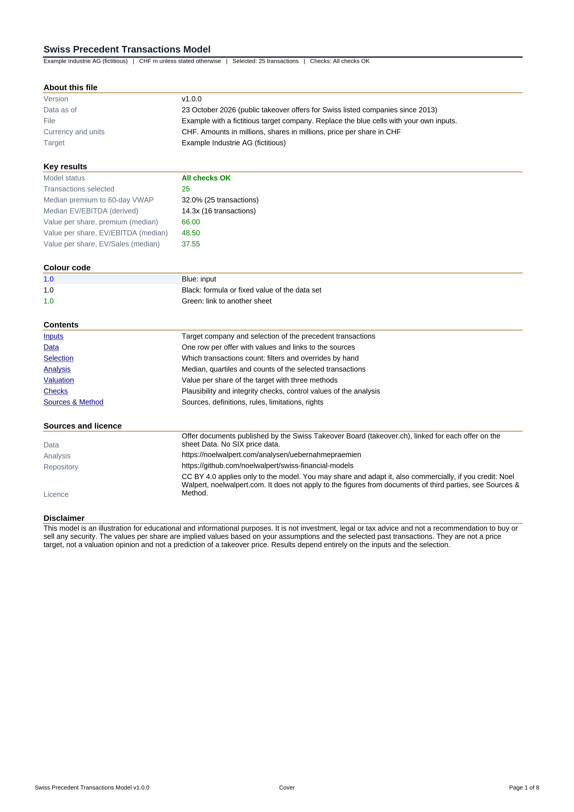
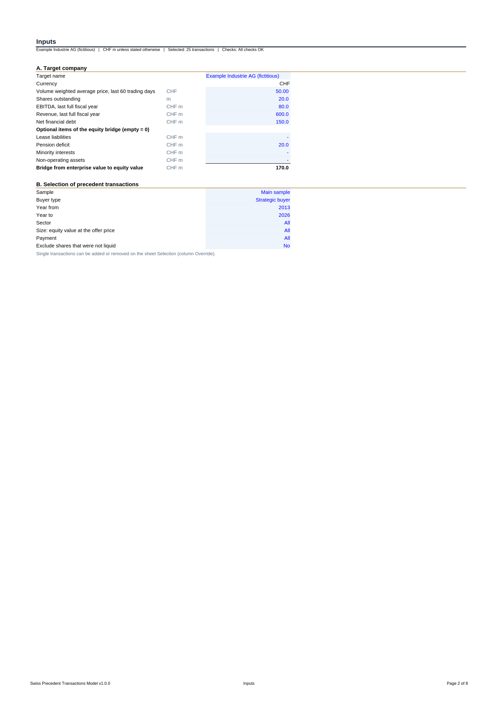
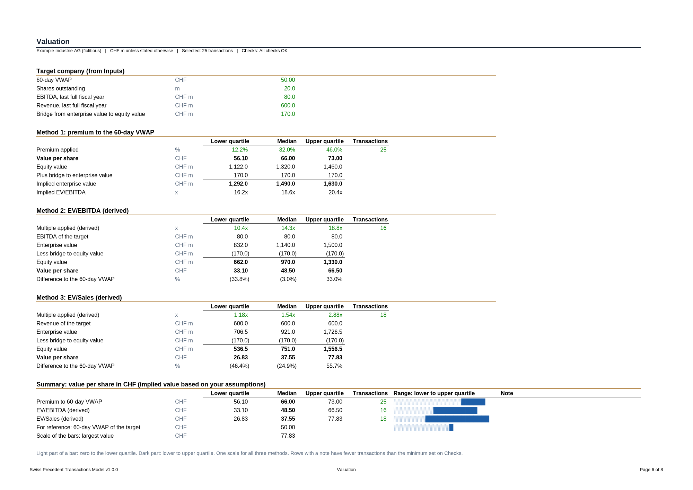

# Swiss Precedent Transactions Model

An Excel model that values a Swiss listed company with precedent public takeovers: which price would the premiums and multiples paid in past Swiss takeovers imply for your target?

Version 1.0.0. Data as of 23 October 2026: all public takeover offers for Swiss listed companies since 2013 (66 offers, 45 in the main sample). Currency: Swiss francs, amounts in millions, shares in millions, price per share in CHF. Analysis with the same data (in German): [noelwalpert.com/analysen/uebernahmepraemien](https://noelwalpert.com/analysen/uebernahmepraemien).

## Files

| File | Content |
|---|---|
| [`swiss-precedent-transactions-template-v1.0.0.xlsx`](swiss-precedent-transactions-template-v1.0.0.xlsx) | Template with the full data set of the takeovers, but no target company. Results show "n/a" and the status "Target inputs missing" until you fill in the blue cells of part A on Inputs |
| [`swiss-precedent-transactions-example-v1.0.0.xlsx`](swiss-precedent-transactions-example-v1.0.0.xlsx) | The same model with an invented target company, "Example Industrie AG (fictitious)", and the filter strategic buyer |



## Who it is for

Students, analysts and investors who want to see what past Swiss takeovers imply for a listed company, with every number traceable to the offer documents. It is a teaching and screening tool, not a fairness opinion and not a replacement for a full valuation.

## The eight sheets

| Sheet | Purpose |
|---|---|
| Cover | Version, data as of, key results, model status, colour code, contents, sources, licence, disclaimer |
| Inputs | Part A: the target company (60-day VWAP, shares, EBITDA, revenue, net financial debt, optional bridge items). Part B: the selection (sample, buyer type, years, sector, size, payment, shares not liquid), each with a drop-down list. Inputs holds only what you enter |
| Data | One row per offer, values only, with a link to the transaction at the Swiss Takeover Board and, where available, to the page in the document |
| Selection | Which transactions count: one row per offer with the filter result, an optional override by hand (1 = include, 0 = exclude) and helper columns for the statistics |
| Analysis | Number of transactions, quartiles, median, mean, minimum and maximum for the premium to the 60-day VWAP, the premium to the last price, EV/EBITDA (derived) and EV/Sales (derived). Success and acceptance rate without pending offers. Size classes. List of the selected transactions |
| Valuation | Value per share of the target with three methods at the lower quartile, median and upper quartile, with the bridge from enterprise value to equity value, and a summary table with a bar per method (light from zero to the lower quartile, dark from the lower to the upper quartile, drawn with REPT so that it looks the same in Excel and LibreOffice) |
| Checks | 22 checks with the statuses OK, WARNING, ERROR, INFO and MISSING, control values (without filters the model must show the same numbers as the published analysis) and the technical settings: minimum group size, check tolerance, bar length |
| Sources & Method | Sources, definitions, rules, limitations, rights and citation |





## Colour code

| Colour | Meaning |
|---|---|
| Blue font, light blue fill | Input. Change these cells |
| Black font | Formula, or a fixed value of the data set on Data and Checks |
| Green font | Link to another sheet |

Cells that are not inputs contain formulas or the values of the data set. Numbers typed into formulas are limited to 0, 1, 3 and 100.

## How to use

1. Open the template in Excel (desktop or browser). Excel calculates the file when it opens. Viewers that do not calculate, for example some preview panes, show empty result cells.
2. On Inputs, fill in part A for your target: the volume weighted average price of the last 60 trading days, shares outstanding, EBITDA and revenue of the last full fiscal year and net financial debt. Leases, pensions, minorities and non-operating assets are optional.
3. In part B, choose the transactions. The default is the main sample without filters. On Selection you can add (1) or remove (0) single transactions by hand.
4. Read the range on Valuation and the statistics on Analysis. Check the status on Checks. An ERROR must be fixed, a WARNING deserves a second look, an INFO is for information only.

Expected result of the example file (strategic buyers, 25 transactions): value per share at the median CHF 66.00 with the premium method, CHF 48.50 with EV/EBITDA (derived, 16 transactions) and CHF 37.55 with EV/Sales (derived, 18 transactions), against a 60-day VWAP of CHF 50.00.

## Method in short

**Premium to the 60-day VWAP.** Offer price divided by the volume weighted average price of the last 60 trading days before the announcement, less 1. This is the reference price of Swiss takeover law, and the prospectus states it. Value per share = VWAP of the target × (1 + premium).

**Multiples (derived).** The fairness opinions do not state the multiple of the offer itself. The data set derives it:

```
Transaction value = offer price × shares issued
                    + net financial debt (+ leases if EBITDA includes IFRS 16,
                    + pensions and minorities if debt-like, + other adjustments)
EV/EBITDA         = transaction value / EBITDA of the last full fiscal year before the announcement
EV/Sales          = transaction value / revenue of the last full fiscal year
```

EV/EBITDA below 0x or above 50x is not meaningful and not used. The financial sector has no multiples. Every multiple in the model is labelled "derived" and shown with its number of transactions.

**Valuation with multiples.**

```
Enterprise value = multiple × EBITDA (or revenue) of the target
Equity value     = enterprise value - net financial debt - leases - pensions - minorities + non-operating assets
Value per share  = equity value / shares
```

**Statistics.** Quartiles with linear interpolation over all values (QUARTILE.INC), as on the website.

**Selection without array formulas.** Helper columns on Selection hold the value of a selected transaction or empty text. MEDIAN, QUARTILE.INC, AVERAGE, MIN, MAX and COUNT ignore text, so the statistics follow the filters without FILTER, SORT or array formulas. The model therefore calculates the same in Excel 2016 and later and in LibreOffice.

## Rules

- **Main sample.** The default selection is the 45 takeovers of operating companies. Real estate and investment companies, unsuccessful competing offers and other special cases stay in the data set with their reason and count only with the sample "All offers".
- **Small groups.** Below eight transactions the model still shows median and quartiles, with a warning next to them and WARNING on Checks. The website does not show these numbers.
- **Pending offers** count for premiums and multiples, never for success and acceptance rate.
- **Shares not liquid** are marked in the data set and counted on Analysis. Their minimum price rests on a valuation, not on the VWAP. Inputs can exclude them.
- **Size classes** use the equity value at the offer price in CHF: below CHF 250m, CHF 250m to 1000m, CHF 1000m and above. One offer of the main sample (Actelion, 2017) has no size class, because the offer price is in USD and the documents give no value in CHF. The model shows it as "No size class" with this reason, and Checks confirms that the classes and this case add up to 45.

## Sources

- Offer prospectuses, reports of the board of directors, fairness opinions, final results and decisions published by the Swiss Takeover Board (takeover.ch). Every row of the data set links to its transaction.
- VWAP and last price are the values stated in the offer prospectus. No price data of SIX are used.
- No documents of third parties are included in this repository, only figures with a link to their source.

## Limits

- Net financial debt is taken at the latest balance sheet date before the offer, sometimes months earlier.
- Adjustments in the fairness opinions are not uniform. Some state only an adjusted or operating EBITDA, which is then used.
- Every takeover has its own situation: control already held, competing bids, minimum price rules. Median and quartiles describe past offers, not a single future one.
- Swiss francs only.
- The result is an implied value based on your assumptions and the selected past transactions. It is not a price target and not a prediction of a takeover price.

## Verification

The same code generates these files and the analysis on noelwalpert.com. Before release the model was checked as follows:

- 22 files with different filters, overrides, boundary cases and the template were recalculated with LibreOffice and compared with the website and with an independent TypeScript implementation. 640 numbers were compared, the largest relative deviation was 2.6e-15, and no cell showed an error value.
- Without filters the model shows the published numbers: premium to the 60-day VWAP median 20.3 % (45 transactions), EV/EBITDA (derived) median 11.6x (21), EV/Sales (derived) median 1.23x (29).
- An independent Python script recalculates the size classes and the example.
- Every file was validated against the XML schemas of Office Open XML (ECMA-376, 5th edition, transitional) with the same markup compatibility rules as Excel, plus the package structure and limits of Excel such as the length of drop-down lists.
- A structure test checks that there are no macros, that every name is defined, that only a fixed list of functions is used, and that both files contain no dashes and none of the words the model must not use.

If you find a difference between Excel and LibreOffice, please write to noel@walpert.ch.

## Cite

Walpert, N. (2026). *Swiss Precedent Transactions Model* (version 1.0.0, data as of 23 October 2026). https://github.com/noelwalpert/swiss-financial-models

## Not investment advice

This model is an illustration for educational and informational purposes. It is not investment, legal or tax advice and not a recommendation to buy or sell any security. Results depend entirely on the inputs and the selection.

## Licence and contact

CC BY 4.0 applies only to the model: its structure, formulas, layout, selection and classification. It does not apply to the figures taken from documents of third parties (the Swiss Takeover Board, the companies and their advisers). These figures are facts from public documents, each with a link to its source, and no rights in these documents are granted. See [LICENSE](../LICENSE). Credit: Noel Walpert, noelwalpert.com. Contact: noel@walpert.ch.
